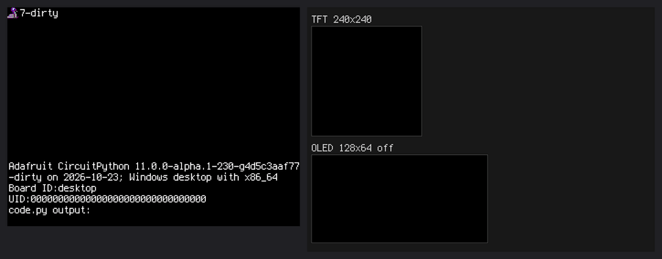
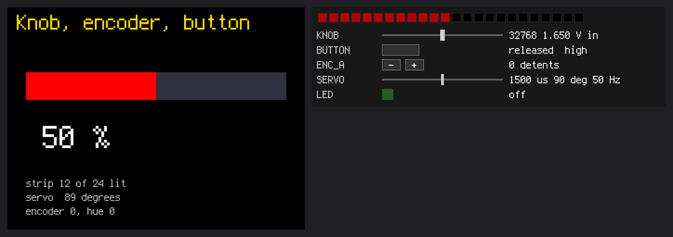

# cp-desktop-lab

**Unofficial.** CircuitPython as a program for Linux, Windows and macOS: the supervisor, the VM and the
CIRCUITPY drive run on your computer, the terminal is the serial console, and a window is the
display. Code written for a board runs as it is, with the same libraries, without a board, or with
real pins through a USB adapter or a Raspberry Pi's header.

This is a fork of [adafruit/circuitpython](https://github.com/adafruit/circuitpython) with one
port added, [`ports/desktop`](../ports/desktop). It is not made or supported by Adafruit; the
rest of the tree is CircuitPython as it is upstream.



## What it does

- **The virtual board:** the window as the display (`displayio`, `terminalio`, `picogame`), the
  keyboard and game controllers as buttons, sound. A board panel shows NeoPixels, buttons,
  switches, sliders and LEDs; virtual I2C sensors (BME280, LIS3DH, SHT31D…) and SPI and I2C
  displays (ST7789, ILI9341, SSD1306…) come from a board file.
- **Real pins:** an FT232H or an MCP2221A on USB, or a Raspberry Pi's own GPIO, I2C and SPI
  (`--board gpiochip`).
- **CIRCUITPY is a folder:** save a file and `code.py` reloads, as on a board. The web workflow
  serves it too.
- **The computer's network** as `socketpool`, `wifi` and `ssl`; a serial port as `busio.UART`.
- **Debugging:** a VS Code extension with breakpoints and stepping, `--trace-bus` for the I2C and
  SPI traffic, a control API and an MCP server for AI assistants.



## Get it

Builds for Linux (x86_64, aarch64), Windows and macOS (Apple silicon) are on the
[Releases](https://github.com/MakerClassCZ/cp-desktop-lab/releases) page. On Linux, SDL2 must be
installed (`libsdl2-2.0-0` on Debian and Ubuntu). The macOS program is not signed by Apple: after
unpacking, `xattr -dr com.apple.quarantine circuitpython-macos-arm64` once.

```
./circuitpython                       # ./CIRCUITPY is created on the first start
./circuitpython --drive path/to/project
./circuitpython --board ft232h        # real pins through an FT232H
./circuitpython --board-file boards/files/pybadge.toml   # a PyBadge's pin names, buttons and NeoPixels
```

`boards/files/` in the package has board files of real boards (Feather, CLUE, PyBadge, PyGamer,
MagTag, MatrixPortal, Circuit Playground, Pico and others), so code written for one finds its pin
names; `examples/panel` shows every part of the board panel.

The VS Code extension is the `.vsix` file on the same page, for all three systems alike: in
VS Code, Extensions > `...` > Install from VSIX.

## A sensor in a minute

Learning Guide code for a BME280 runs as it is: the driver looks for the sensor, and the virtual
board plugs one in and says so:

```
virtual: BME280 attached at I2C 0x77 (automatic)
```

Its values are sliders on the board panel, and attributes in the REPL:

```python
>>> import board
>>> board.attached["BME280"].temp = 30
```

`board.parts` lists every part that can be plugged in; `board.attach` and `board.detach` plug
them in and out from `code.py` or the REPL
([README](../ports/desktop/README.md#plugging-parts-in-from-python)).

## Use it with an AI assistant

`cp_mcp.py` in the package is an MCP server (Python 3, standard library only). Through it an
assistant starts the program on a project folder, runs code in the REPL, reads the console, moves
the board panel's parts, looks at the displays as images and reads and writes the files, so it
can try the code it writes before it reaches a board.

Claude Code:

```
claude mcp add circuitpython -- python3 /path/to/package/cp_mcp.py
```

Claude Desktop, in `claude_desktop_config.json` (on Windows `python` and a `C:\\...` path):

```json
{"mcpServers": {"circuitpython": {"command": "python3", "args": ["/path/to/package/cp_mcp.py"]}}}
```

The server finds the program beside it; `--program PATH` names another.

How to build it, every option and what is missing: [`ports/desktop/README.md`](../ports/desktop/README.md).

## Status

Experimental. It follows CircuitPython's `main` branch. Problems and ideas go to this repository's
issues, not to Adafruit's.
